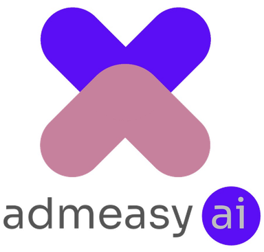
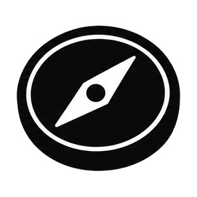
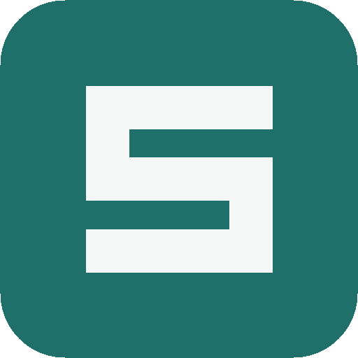

# Admeasy-ai is private, Opensource: [Compass](https://github.com/aadeshadmeasy/compass) · [SI Code](https://github.com/aadeshadmeasy/SI-Code)

 <a href="https://github.com/aadeshadmeasy/compass"></a> <a href="https://github.com/aadeshadmeasy/SI-Code"></a>


## 🌐 Socials:
[](https://instagram.com/aadesh.panwar_) [](https://linkedin.com/in/aadesh-panwar/) [](mailto:aadesh.panwar@admeasy.in) 

# 💻 Tech Stack:
         
# 📊 GitHub Stats:
<br/>
<br/>


# Hi, I'm Aadesh 👋

### Founder & AI Engineer · Building Autonomous Agentic AI

I build **autonomous AI systems, multi-agent architectures, and AI employees** designed to execute real-world work with minimal human intervention.

> **“Enabling non-tech founders to build autonomous AI employees in one prompt.”**

---

##  What I'm Building

### Admeasy AI · Founder & AI Engineer


📍 New Delhi, India · **August 2026 – Present**

Building **autonomous AI employees for enterprises today, and humanoid robots tomorrow.**

-  Pioneering **WorkFold in AWE** — a new approach for making token-heavy multi-agent systems execute more efficiently.
-  Building **Agent Work Environment (AWE)** — an environment where multiple AI employees can simultaneously **plan, work, delegate, critique, and report**.
-  Built a **multi-agent orchestrator** with an **anomaly detector loop** for autonomous operations.
-  Enabled AI employees to work with **MCP tools, internal tools, and external tool calls** while executing objectives.
-  Building objective-oriented, autonomous **agentic AI systems** capable of operating beyond simple prompt-response workflows.

---

### Compass · Open-Source Model


📍 **September 2026 – Present** · [](https://github.com/aadeshadmeasy/compass/blob/main/LICENSE) · [Live demo](https://compass-self-nu.vercel.app) · [GitHub](https://github.com/aadeshadmeasy/compass)

A tiny, fast **MCP tool ranker**: plain English in, ranked tools out, from candidate sets of tens to thousands of MCP tools. Built for AI agent tool calling.

-  Not an LLM agent loop. Compass learns to *rank* whatever candidates you provide, so routing stays **sub-millisecond locally** and cheap on serverless.
-  Trained on **600k hard-negative rows** against a **~32k enriched tool catalog**, served on an AWS SageMaker serverless endpoint.
-  Open-sourced under **Apache 2.0** with a ~10k-tool stratified catalog sample and ~2k public routing trajectories.
-  Built with Nitish and Divya on AWS SageMaker and Jupyter.

---

### SI Code · Open-Source AI Code Editor


📍 **October 2026 – Present** · [](https://github.com/aadeshadmeasy/SI-Code/blob/main/LICENSE.txt) · [Download latest](https://github.com/aadeshadmeasy/SI-Code/releases/latest) · [GitHub](https://github.com/aadeshadmeasy/SI-Code)

-  A free, open-source alternative to VS Code and Cursor, built on **Code - OSS**.
-  **Bring your own key** — OpenAI, Anthropic, Gemini, OpenRouter, Sarvam, and Ollama/OpenAI-compatible.
-  **AI chat**, **inline edit**, and an **agent mode** that edits across files and runs terminal commands with approval.
-  Works with **local and remote MCP servers**, including OAuth sign-in.
-  Builds for **Windows, macOS, and Linux**.

---

### Schoolzy AI · Co-Founder
📍 Indore, India · **May 2026 – Present**

Building **autonomous agentic AI for school administration**.

-  Generated early revenue and partnered with **3 schools**.
-  Pioneered **two patentable methodologies** for autonomous AI systems.
-  Built a **domain-specialized multi-agent orchestrator** that can initiate operations from an anomaly detector rather than waiting for a human prompt.
-  Built a **backend-aware autonomous agentic browser** designed to overcome limitations of UI/DOM-only agents.
-  Fed application **routes, business logic, and database schema** into the browser-agent + LLM system to improve execution accuracy.

---

### Admeasy.in · Co-Founder & CEO
📍 Remote + New Delhi, India · **March 2025 – May 2026**

Built **Admeasy.in**, a LinkedIn-style platform for school students. 

-  Grew to **70K+ website impressions**.
-  Built and worked with a passionate **17-member team**.
-  Managed **social media campaigns and webinar marketing**.
-  Built Admeasy.in into a ready-to-go brand focused on **mentorship and studies**.
-  The startup was eventually wound down, with the experience becoming the foundation for my work in AI and autonomous systems.

---

##  Technical Focus

```text
Agentic AI Development       ████████████████████  Expert
Multi-Agent Orchestration    ██████████████████░░  Advanced
Agent Work Environment       ██████████████████░░  Advanced
Langchain                    ██████████████████░░  Advanced
RAG & Vector Systems         ██████████████████░░  Advanced
Cursor IDE                   ██████████████████░░  Advanced


